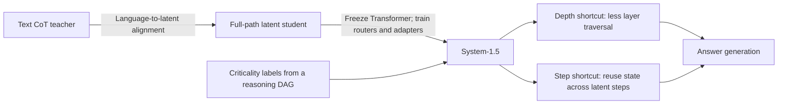

# System-1.5 Reasoning — a reading guide

An unofficial, original companion to **System-1.5 Reasoning: Traversal in Language and Latent Spaces with Dynamic Shortcuts**, by **Xiaoqiang Wang, Suyuchen Wang, Yun Zhu, and Bang Liu**.

**Source scope:** [arXiv:2505.18962v3](https://arxiv.org/abs/2505.18962v3), dated **31 May 2025**; [15-page PDF](https://arxiv.org/pdf/2505.18962v3). This guide covers the whole v3 paper, including its references. **There are no appendices in this version.** This repository is a reading companion, not the authors' implementation or an experimental reproduction. It is unaffiliated with the paper's authors and institutions.

## The idea in a minute

Writing every intermediate thought as text costs decoding time. Replacing that text with hidden states can shorten the sequence, but still leaves a decision: how much computation should each hidden-state update receive?

The paper proposes two shortcuts inside a latent reasoning model. A **depth shortcut (DS)** lets a learned router use a lightweight adapter instead of continuing through deeper Transformer layers. A **step shortcut (SS)** carries an intermediate state into the next latent step at the same layer, avoiding a fresh traversal from the bottom. Two training stages first teach a student to use latent reasoning, then teach router-adapter modules while freezing that student's Transformer parameters. See [§2, pp. 3–7](https://arxiv.org/pdf/2505.18962v3#page=3).



*Guide interpretation:* the useful contribution is joint control over **where** and **for how long** the model computes. “System-1.5” is the authors' name and cognitive analogy; these experiments do not establish a model of human cognition.

## What the evidence says

The following values are **reported in Table 1, p. 7**, not measured by this guide. The table does not identify which of the two named backbones applies to each row. Speedups are wall-clock ratios against the paper's CoT baseline, with no hardware or batch-size protocol specified in v3. [Source](https://arxiv.org/pdf/2505.18962v3#page=7).

| Dataset | CoT accuracy | System-1.5 accuracy | Steps: CoT → System-1.5 | Reported speedup |
| --- | ---: | ---: | ---: | ---: |
| GSM8K | 46.94% | 46.66% | 26 → 2 | 20.27× |
| GSM-HARD | 38.32% | 38.28% | 26 → 4 | 12.45× |
| StrategyQA | 47.62% | 48.61% | 52 → 2 | 55.65× |

These are tradeoffs, not identical accuracies: the mathematical datasets decrease by 0.28 and 0.04 percentage points, while StrategyQA increases by 0.99 points. No uncertainty estimates or significance tests are reported. The GSM8K intermediate-step reduction is `1 − 2/26 = 92.31%`; this does not mean total inference FLOPs or total generated answer tokens fall by that amount.

**Read before quoting a headline:** §3.1 prose on p. 8 swaps or changes several accuracy values relative to Table 1, the introduction says 91.0% where the abstract says 92.31%, and Eq. 10's prose and displayed target use different layer descriptions. We preserve these conflicts in the [limitations module](docs/05-limitations-and-open-questions.md) and [structured claim ledger](metadata/claims.json).

## Choose a reading route

| Your goal | Route |
| --- | --- |
| Understand the central idea in 15 minutes | This README → [problem and context](docs/01-problem-and-context.md) → [results](docs/04-experiments-and-results.md) → [limitations](docs/05-limitations-and-open-questions.md) |
| Work through the technical design | [Notation](docs/glossary.md) → [shortcuts](docs/02-dynamic-shortcuts.md) → [training](docs/03-training-and-objectives.md) → [reproduction questions](docs/06-discussion-and-reproduction.md) |
| Read alongside the actual paper | [Complete paper map](docs/00-reading-map.md), then follow each section and figure in the v3 PDF |
| Audit a claim or number | [Claim ledger](metadata/claims.json) → [Table 1 CSV](data/reported-results.csv) / [Figure 4 CSV](data/test-time-scaling.csv) → exact paper page |
| Give an agent bounded context | [AGENTS.md](AGENTS.md) → [agent navigation](agents/README.md) → [LLMS.txt](LLMS.txt) |

## Human reading modules

1. [Problem, context, and the cognitive analogy](docs/01-problem-and-context.md): what the method changes and how the paper positions related work.
2. [Dynamic shortcuts](docs/02-dynamic-shortcuts.md): vertical and horizontal computation, routers, thresholds, and inference flow.
3. [Training and objectives](docs/03-training-and-objectives.md): teacher-forcing, answer-position alignment, criticality labels, and frozen parameters.
4. [Experiments and results](docs/04-experiments-and-results.md): all baselines, metric meanings, ablations, and the scaling grid.
5. [Limitations and open questions](docs/05-limitations-and-open-questions.md): source inconsistencies, missing details, and boundaries on the conclusions.
6. [Discussion and reproduction](docs/06-discussion-and-reproduction.md): comprehension exercises and a proposed experimental checklist.

The [glossary](docs/glossary.md) explains the notation. [Attribution](ATTRIBUTION.md), [source provenance](metadata/sources.json), and [paper metadata](metadata/paper.json) make the source boundary explicit.

## For agents

Example request:

> Use AGENTS.md and the v3 claim ledger. Explain why 20.27× is a reported GSM8K speedup, name the baseline and metric, and separate evidence from possible causes. Flag missing hardware details and Table 1/prose conflicts. Do not present these notes as a reproduction.

The guide uses **paper report** for the authors' method or observations, **authors' explanation** for their causal interpretation, and **guide interpretation/proposal** for our own reasoning. Numerical CSVs are transcriptions of displayed results; they are not new runs or raw predictions.

## Validate and contribute

Run the dependency-free checker from the repository root:

```sh
python scripts/validate_repository.py
```

It checks local links and anchors, metadata, the 24 Table 1 records and 36 Figure 4 cells, selected cross-file values, and exclusion of PDFs/full extracted source. It does not validate the paper's empirical results. See [VERIFICATION.md](VERIFICATION.md) for publication checks and [CONTRIBUTING.md](CONTRIBUTING.md) for evidence rules.

## Credit, citation, and rights

Research credit belongs to **Xiaoqiang Wang, Suyuchen Wang, Yun Zhu, and Bang Liu**. The title page lists DIRO & Institut Courtois, Université de Montréal; Mila – Quebec AI Institute; and the Canada CIFAR AI Chair, with Bang Liu marked as corresponding author. Do not infer an affiliation for Yun Zhu from the superscripts absent beside that name.

Guide maintained by [0xHayd3n](https://github.com/0xHayd3n), prepared with OpenAI Codex assistance. Cite the research using [references/paper.bib](references/paper.bib); [CITATION.cff](CITATION.cff) identifies this companion and its preferred research citation.

The [MIT license](LICENSE) applies only to original guide material and validation code. The source paper and other cited works retain their own rights. No source PDF, full extracted paper text, or copied paper figures are distributed. The supplied attachment was identified in the parent task; local full-paper reading used the matching official v3 PDF because the Library transfer helper was unavailable. See [the provenance record](metadata/sources.json).
